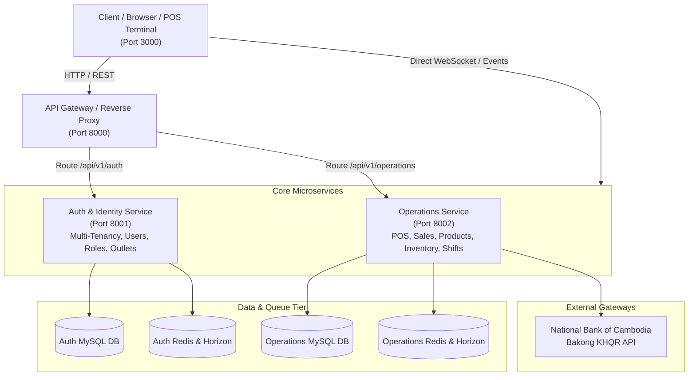
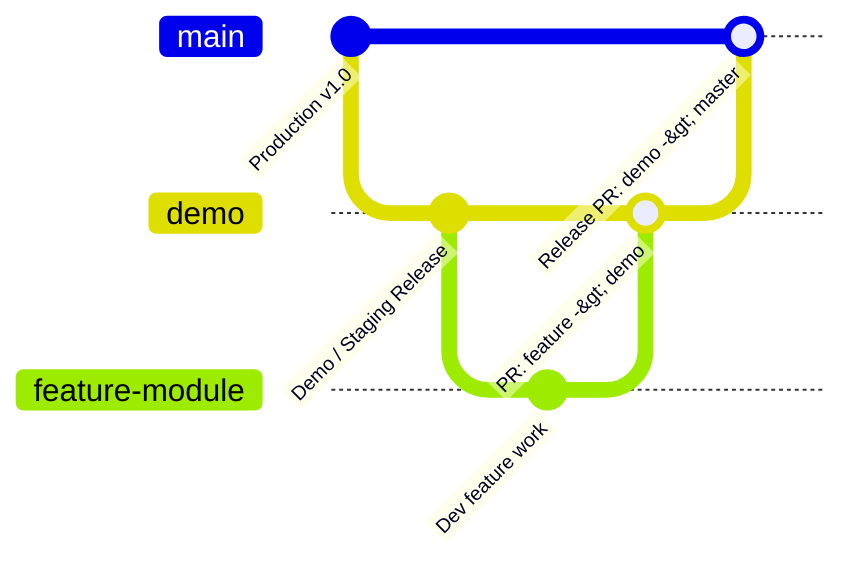

<div align="center">

# 🌉 CodeBridges (Codebridge404)
### Enterprise Multi-Tenant SaaS Platform for Modern Retail, POS & Operations

[](https://nextjs.org/)
[](https://react.dev/)
[](https://laravel.com/)
[](https://php.net/)
[](https://www.docker.com/)
[](https://mysql.com/)
[](https://redis.io/)
[](https://bakong.nbc.gov.kh/)

<p align="center">
  A cloud-native, distributed microservice enterprise management system featuring high-throughput Point of Sale (POS), Kitchen Display Systems (KDS), Customer-Facing Displays (CFD), multi-outlet inventory, and real-time Bakong KHQR dynamic cashless payments.
</p>

---

</div>

## 📑 Core Repositories

| Repository | Description | Primary Stack | Default / Staging Branch |
| :--- | :--- | :--- | :--- |
| [**`codebridgesfront`**](https://github.com/Codebridge404/codebridgesfront) | Modern high-performance web client, POS terminal UI, and Organization management dashboard. | Next.js 16, React 19, Tailwind CSS 4, Framer Motion | `master` / `demo` |
| [**`codebridge-services`**](https://github.com/Codebridge404/codebridge-services) | Distributed microservices backend architecture powered by Docker, Laravel 11, Redis, and Horizon. | Laravel 11, PHP 8.2, Docker Compose, MySQL, Redis | `master` / `demo` |

---

## 🏛️ System Architecture



---

## 👥 Organization & Team Structure

- **Lead & Organization Owner**: [@VibolSen](https://github.com/VibolSen)
- **Development Team ([`@Codebridge404/developers`](https://github.com/orgs/Codebridge404/teams/developers))**:
  - [@kheangsenghorng](https://github.com/kheangsenghorng)
  - [@ChenSreyneat](https://github.com/ChenSreyneat)
  - [@khornSaokhouch](https://github.com/khornSaokhouch)

---

## 🌿 GitFlow & Contribution Guidelines

We enforce a structured, branch-protected development workflow:



1. **`master` (Production)**:
   - Protected: Direct pushing and force pushing are blocked.
   - Merges strictly from `demo` via reviewed and approved Pull Requests by Organization Admin (@VibolSen).
2. **`demo` (Staging / Integration)**:
   - Protected: The single source of truth for upcoming releases and team demos.
   - All feature branches must target and merge into `demo` first.
3. **`feature/*` / `fix/*` (Working Branches)**:
   - Branch off `demo`: `git checkout -b feature/your-feature-name`
   - Test locally and push: `git push -u origin feature/your-feature-name`
   - Open Pull Request targeting `demo`.
   - Ensure automated GitHub Actions CI tests pass before review.

---

## 🚀 Quick Setup & Local Development

### 1. Backend Microservices
```bash
git clone https://github.com/Codebridge404/codebridge-services.git
cd codebridge-services

# Start the Docker microservices stack
docker compose up -d --build
```
- API Gateway: `http://localhost:8000`
- Auth Service: `http://localhost:8001`
- Operations Service: `http://localhost:8002`

### 2. Frontend Client
```bash
git clone https://github.com/Codebridge404/codebridgesfront.git
cd codebridgesfront

npm install
npm run dev
```
- Web Application & POS: `http://localhost:3000`

---

<div align="center">
  <sub>© 2026 Codebridge404. Built with precision for modern commerce.</sub>
</div>